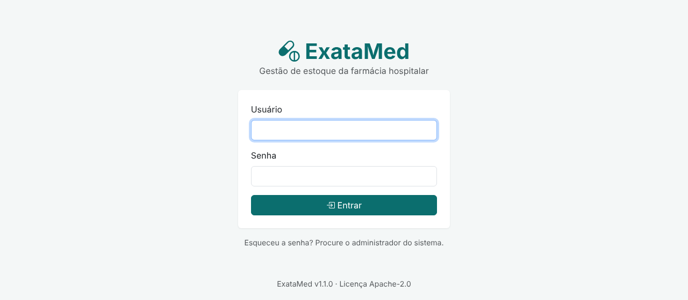
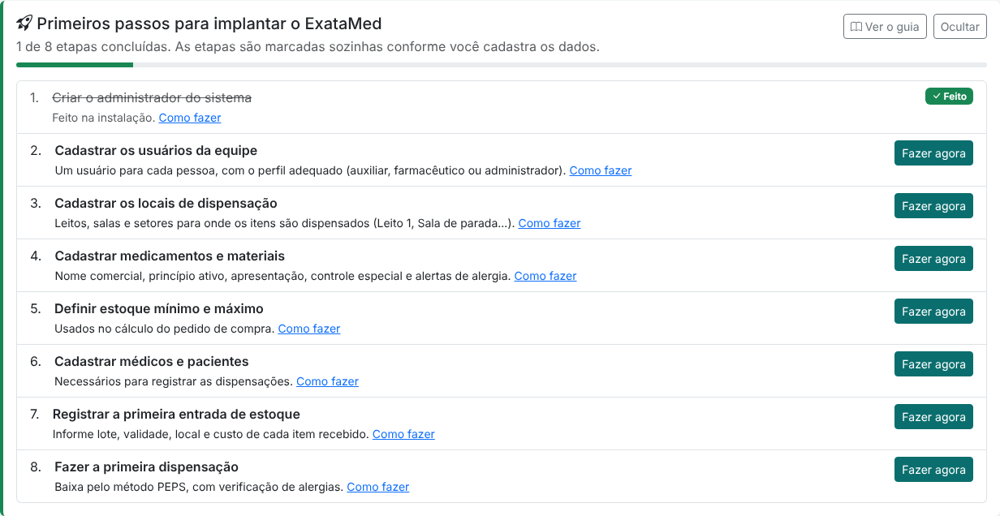
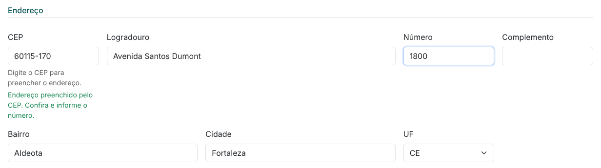
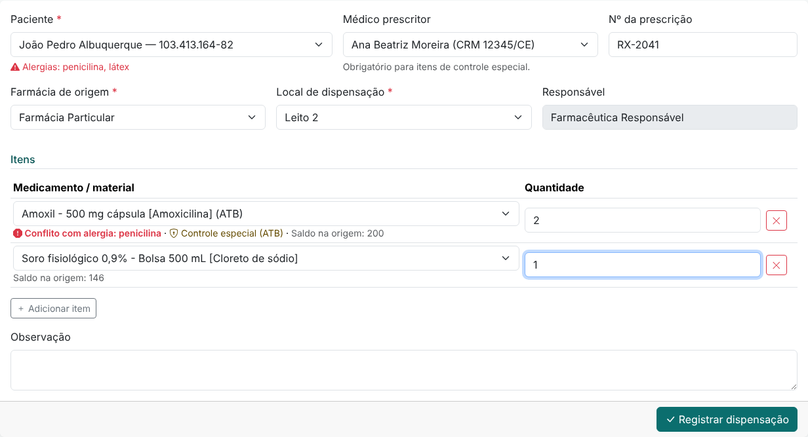
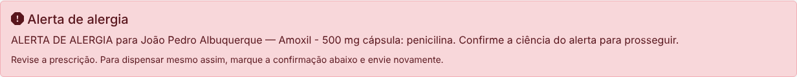

# Guia do usuário do ExataMed

Este guia ensina a usar o ExataMed no dia a dia da farmácia hospitalar. Ele também está
disponível dentro do sistema, no menu **Ajuda**.

| Se você é... | Comece por |
|---|---|
| **Auxiliar de farmácia** | [Primeiro acesso](#primeiro-acesso), [Conhecendo o painel](#conhecendo-o-painel) e [Dispensação no dia a dia](#dispensação-no-dia-a-dia) |
| **Farmacêutico(a)** | Os itens acima e também [Outras operações de estoque](#outras-operações-de-estoque) e [Relatórios](#relatórios) |
| **Administrador(a)** | [Roteiro de implantação](#roteiro-de-implantação-administrador) e [Gestão de usuários](#gestão-de-usuários-administrador) |

## Primeiro acesso

1. Abra o endereço do sistema no navegador (o administrador informa qual é).
2. Digite o **usuário** e a **senha** que o administrador entregou.
3. No primeiro acesso, o sistema pede uma **senha nova**: informe a senha recebida e crie uma
   senha pessoal com pelo menos 8 caracteres, misturando letras e números.

Bom saber:

- A sessão dura 8 horas. Depois disso, é preciso entrar novamente.
- Depois de **5 senhas erradas**, o usuário fica bloqueado por 15 minutos. O administrador pode
  desbloquear antes disso.
- **Esqueceu a senha?** Peça ao administrador para definir uma senha provisória.
- Para trocar a senha a qualquer momento, clique no seu nome, no canto superior direito, e
  escolha **Alterar minha senha**.
- Para sair, clique no seu nome e escolha **Sair**. Não deixe o sistema aberto em computador
  compartilhado: tudo o que for feito fica registrado no seu nome.

## Conhecendo o painel

O painel é a primeira tela depois do login. Ele mostra:

- **Indicadores do dia:** itens ativos, pacientes, dispensações de hoje, consumo de hoje e valor
  total do estoque.
- **Itens a repor:** produtos que chegaram ao estoque mínimo, com a quantidade sugerida para compra.
- **Lotes vencidos ou a vencer:** lotes que vencem nos próximos 90 dias (em amarelo) ou já
  vencidos (em vermelho).
- **Últimas dispensações:** clique no número para abrir o comprovante.

O menu superior dá acesso a todas as funções:

| Menu | O que tem |
|---|---|
| **Cadastros** | Pacientes, médicos, medicamentos e materiais, localizações |
| **Estoque** | Entrada, saída avulsa, transferência, lotes e saldos, movimentações, contagem de inventário |
| **Dispensação** | Registro de dispensação para um paciente |
| **Relatórios** | As seis análises gerenciais |
| **Ajuda** | Este guia |

O menu mostra apenas as funções permitidas para o seu perfil. Veja
[O que cada perfil pode fazer](#o-que-cada-perfil-pode-fazer).

## Roteiro de implantação (administrador)

Logo após a instalação, o painel do administrador mostra o quadro **Primeiros passos**. Cada
etapa é marcada sozinha quando os dados são cadastrados, e o botão **Fazer agora** leva direto à
tela certa. O quadro some quando todas as etapas estiverem concluídas. Para escondê-lo antes,
clique em **Ocultar**; para mostrá-lo de novo, use o botão na lateral desta página de Ajuda.

Siga as etapas nesta ordem:

### 1. Usuários da equipe

Crie um usuário para cada pessoa da equipe. Não compartilhe usuários: cada movimentação fica
registrada em nome de quem a fez. Veja [Gestão de usuários](#gestão-de-usuários-administrador).

### 2. Locais de dispensação

O sistema já vem com a **Farmácia SUS** e a **Farmácia Particular**, que são os estoques
principais. Cadastre os locais para onde os itens são dispensados ou transferidos:

1. Acesse **Cadastros → Localizações → Novo**.
2. Informe o nome (por exemplo *Leito 1*, *Sala de parada*, *Sala de recuperação*, *UTI*) e, se
   quiser, uma descrição.

Um local que já tem movimentações não pode ser excluído, mas pode ser **desativado**: basta
desmarcar *Ativa*. Incluir, editar e excluir localizações é permitido apenas aos perfis
**farmacêutico** e **administrador**; o auxiliar só consulta.

### 3. Medicamentos e materiais

Acesse **Cadastros → Medicamentos e materiais → Novo** e preencha:

| Campo | Orientação |
|---|---|
| **Tipo** | Medicamento ou material médico-hospitalar |
| **Nome comercial** e **princípio ativo (DCB)** | O princípio ativo também é usado na verificação de alergias |
| **Apresentação** | Por exemplo *500 mg comprimido* ou *1 g/2 mL ampola* |
| **Unidade de medida** | A unidade em que o item é contado e dispensado (AMP, CP, FR, UN...) |
| **Controle especial** | A lista da Portaria 344/98 (A1, B1, C1...) ou antimicrobiano. Itens controlados exigem médico e número da prescrição, e só o farmacêutico pode dispensá-los |
| **Alertas de alergia** | Substâncias ou classes que disparam alerta, separadas por vírgula. Exemplo: *penicilinas, betalactâmicos* |
| **Estoque mínimo e máximo** | Quando o saldo chega ao mínimo, o sistema sugere comprar até o máximo |

**Lote, validade, localização e custo não ficam no cadastro do produto:** eles são informados em
cada entrada de estoque, porque o mesmo produto pode ter vários lotes.

### 4. Médicos e pacientes

- **Médicos:** em **Cadastros → Médicos**. O CRM e a UF são obrigatórios e não podem se repetir.
- **Pacientes:** em **Cadastros → Pacientes**. O sistema confere se o CPF e o Cartão Nacional
  do SUS são válidos e calcula a idade pela data de nascimento. Para menores de 18 anos, o nome
  do responsável e o grau de parentesco são obrigatórios.

**Endereço pelo CEP:** ao digitar os 8 números do CEP, o sistema preenche sozinho o logradouro,
o bairro, a cidade e a UF. Depois, informe o número e, se houver, o complemento. Se o CEP não
for encontrado ou a consulta não responder, preencha o endereço manualmente.

> **Registre as alergias conhecidas** separadas por vírgula (por exemplo *dipirona, penicilina,
> látex*). Elas são conferidas automaticamente a cada dispensação.

### 5. Entrada de estoque

Ao receber produtos (nota fiscal, empenho, doação):

1. Acesse **Estoque → Entrada**.
2. Escolha o produto e o local onde ele será guardado (normalmente a Farmácia SUS ou a Particular).
3. Informe o **lote**, a **validade**, a **quantidade** e o **custo unitário**. O número do documento é opcional.
4. Clique em **Registrar entrada**.

Cada lote recebido vira uma camada de custo. Não é possível dar entrada em lote vencido.

### 6. Primeira dispensação

Faça uma dispensação de teste seguindo [Dispensação no dia a dia](#dispensação-no-dia-a-dia).
Com isso, o quadro de primeiros passos fica completo.

## Dispensação no dia a dia

1. Acesse **Dispensação** no menu.
2. Escolha o **paciente**. As alergias registradas aparecem logo abaixo do nome.
3. Informe o **médico prescritor** e o **número da prescrição**, obrigatórios para itens de
   controle especial.
4. Escolha a **farmácia de origem** (de onde sai o estoque) e o **local de dispensação** (leito,
   sala ou setor que recebe os itens). A origem é sempre a **Farmácia SUS** ou a **Farmácia
   Particular**.
5. Adicione os itens e as quantidades. Use **Adicionar item** para incluir mais linhas.
6. Clique em **Registrar dispensação**. O sistema gera o **número da dispensação** no formato
   número/ano (por exemplo **00001/2026**). A numeração recomeça em 00001 a cada ano. O
   comprovante abre em seguida e pode ser impresso.

Enquanto você preenche, cada item mostra o **saldo disponível na origem**, se é de **controle
especial** e se há **conflito com as alergias** do paciente.

### Quando a dispensação é bloqueada

| Mensagem | O que fazer |
|---|---|
| **Alerta de alergia** | Revise a prescrição com o médico. Se a dispensação for mantida, um **farmacêutico** marca a confirmação de ciência e envia novamente. A confirmação fica registrada na observação |
| **Controle especial** | Informe o médico e o número da prescrição. Se você é auxiliar, peça a um farmacêutico para fazer a dispensação |
| **Saldo insuficiente** | A origem não tem quantidade suficiente em lotes dentro da validade. Confira em **Estoque → Lotes e saldos** ou faça uma transferência de outro local |
| **Local igual à origem** | O local de dispensação precisa ser diferente da farmácia de origem |
| **Origem não permitida** | A dispensação só sai da Farmácia SUS ou da Farmácia Particular. Para atender um setor a partir do estoque dele, faça antes uma transferência de volta para a farmácia |

Lotes vencidos nunca são dispensados, mesmo que tenham saldo.

## Outras operações de estoque

| Operação | Onde | Quem | Para que serve |
|---|---|---|---|
| **Transferência** | Estoque → Transferência | Todos | Mover itens entre locais (por exemplo, da farmácia para a UTI). Lote, validade e custo são mantidos |
| **Saída avulsa** | Estoque → Saída avulsa | Farmacêutico | Consumo de setor, perda, avaria, quebra ou devolução ao fornecedor. O motivo é obrigatório |
| **Contagem de inventário** | Estoque → Contagem de inventário | Farmacêutico | Conferir o estoque físico de um local e corrigir as diferenças |
| **Lotes e saldos** | Estoque → Lotes e saldos | Todos | Ver o saldo de cada lote, com validade e custo |
| **Movimentações** | Estoque → Movimentações | Todos | Histórico completo, com data, tipo, quantidade, custo e usuário |

**Contagem de inventário, passo a passo:**

1. Escolha o local e clique em **Carregar lotes**.
2. Digite a quantidade contada em cada lote. Lotes deixados em branco não são alterados.
3. Informe o motivo (por exemplo *inventário mensal*) e clique em **Aplicar ajustes**.

Para dar baixa em um lote vencido, use a contagem de inventário e informe a quantidade **0**
nesse lote.

## Relatórios

Acesse **Relatórios** no menu. Todos os relatórios podem ser **impressos** ou **exportados em
CSV**, que abre direto no Excel.

| Relatório | Use para |
|---|---|
| **Consumo diário** | Acompanhar o custo do consumo dia a dia e a média diária de cada produto |
| **Resumo de dispensação por data** | Saber quantas dispensações e pacientes foram atendidos em cada dia |
| **Consumo por local de dispensação** | Comparar o consumo entre leitos, salas e setores |
| **Consumo por paciente** | Ver o que cada paciente recebeu e o custo (útil para faturamento) |
| **Estoque mínimo/máximo e pedido de compra** | Montar o pedido de compra: mostra o saldo, o consumo médio, para quantos dias o estoque dá e quanto comprar |
| **Inventário** | Ver a posição do estoque por lote e local, com o valor total e os lotes perto do vencimento |

O atalho **Consumo** na lista de pacientes abre o consumo daquele paciente nos últimos 12 meses.

## Como funciona o custo PEPS

O ExataMed calcula o custo pelo método **PEPS: primeiro que entra, primeiro que sai**. Em cada
saída, o sistema consome primeiro o lote que entrou há mais tempo, usando o custo daquele lote.

> **Exemplo:** entraram 5 ampolas a R$ 2,00 no dia 1 e 10 ampolas a R$ 3,00 no dia 10. Uma
> dispensação de 8 ampolas consome as 5 do primeiro lote e 3 do segundo:
> 5 × R$ 2,00 + 3 × R$ 3,00 = **R$ 19,00**. As 7 ampolas restantes ficam valorizadas a R$ 3,00.

O comprovante de dispensação mostra exatamente quais lotes foram usados e o custo de cada um.

## Gestão de usuários (administrador)

Acesse o menu com o seu nome → **Usuários**.

- **Novo usuário:** informe nome, login, perfil e uma senha inicial. Essa senha é provisória: a
  pessoa precisa trocá-la no primeiro acesso.
- **Redefinir senha:** edite o usuário e preencha uma nova senha. Ela também será provisória.
- **Desbloquear:** usuários bloqueados por tentativas erradas aparecem com o botão **Desbloquear**.
- **Desligamento da equipe:** edite o usuário e desmarque **Ativo**. O histórico dele é mantido.
- O registro profissional (CRF) é opcional e aparece no comprovante de dispensação.

Você não pode remover o seu próprio perfil de administrador. Isso evita que o sistema fique sem
nenhum administrador.

## O que cada perfil pode fazer

| Função | Auxiliar | Farmacêutico | Administrador |
|---|:---:|:---:|:---:|
| Consultar estoque, movimentações e relatórios | ✔ | ✔ | ✔ |
| Cadastrar pacientes e médicos | ✔ | ✔ | ✔ |
| Entrada de estoque e transferência | ✔ | ✔ | ✔ |
| Dispensar itens sem controle especial | ✔ | ✔ | ✔ |
| Dispensar itens de controle especial | | ✔ | ✔ |
| Liberar dispensação com alerta de alergia | | ✔ | ✔ |
| Saída avulsa e contagem de inventário | | ✔ | ✔ |
| Cadastrar medicamentos e localizações | | ✔ | ✔ |
| Excluir registros | | ✔ | ✔ |
| Gerenciar usuários | | | ✔ |

## Perguntas frequentes

**Por que não consigo excluir um paciente, produto ou local?**
Registros que já têm movimentações não podem ser excluídos, para preservar o histórico. Produtos
e locais podem ser desativados.

**O saldo aparece, mas o sistema diz que não há estoque suficiente.**
Provavelmente parte do saldo está em lotes vencidos, que não podem ser dispensados. Confira em
**Estoque → Lotes e saldos**.

**Cadastrei a alergia, mas o alerta não apareceu.**
A verificação compara as alergias do paciente com o nome comercial, o princípio ativo e os
alertas de alergia do produto. Confira se as alergias estão separadas por vírgula e se o produto
tem os alertas preenchidos (por exemplo *penicilinas, betalactâmicos*).

**Como encontro uma dispensação pelo número?**
O relatório **Resumo de dispensação por data** lista o número de cada dispensação do período. Na
tela **Estoque → Movimentações** e nas *Últimas dispensações* do painel, clique no número para
abrir o comprovante.

**Onde vejo quem fez uma movimentação?**
Em **Estoque → Movimentações**, na coluna *Usuário*, e no comprovante de cada dispensação.

**O sistema diz que o formulário expirou.**
A página ficou aberta por muito tempo ou a sessão terminou. Recarregue a página e tente de novo.
